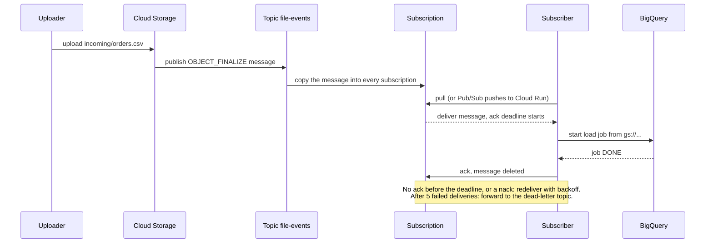

# GCS → Pub/Sub → BigQuery ingestion pipeline (Windows edition)

A small, end-to-end example of event-driven ingestion on Google Cloud, built for learning.
Drop a CSV into a bucket and a few seconds later its rows are in BigQuery. Files that fail are
retried, then parked in a dead-letter topic instead of blocking everything. A Streamlit dashboard
lets you upload files and watch them travel through the pipeline.

This version is written for **Windows 10/11 with PowerShell**. Every command runs in PowerShell
unless it says otherwise. Where a repository script is a Bash file (`.sh`), the guide tells you how
to run it on Windows (Git Bash or WSL).

```
Uploader ─▶ Cloud Storage ──(OBJECT_FINALIZE)──▶ Pub/Sub topic ─▶ Subscription ─▶ Subscriber ─▶ BigQuery
(Streamlit,                                                            │
 gcloud, app)                                          after 5 failed  │
                                                          attempts     ▼
                                                                 Dead-letter topic
```

The message carries **metadata only** (bucket, object name, generation). The subscriber never
downloads the file: it asks BigQuery to load it directly from `gs://`.

## Contents

1. [Pub/Sub explained](#1-pubsub-explained)
2. [The components, one by one](#2-the-components-one-by-one)
3. [Project layout](#3-project-layout)
4. [Prerequisites (Windows)](#4-prerequisites-windows)
5. [Run the tests locally](#5-run-the-tests-locally)
6. [Deploy the infrastructure](#6-deploy-the-infrastructure) (Terraform **or** gcloud script)
7. [Start a subscriber](#7-start-a-subscriber) (local pull **or** Cloud Run push)
8. [Streamlit dashboard: upload and watch](#8-streamlit-dashboard-upload-and-watch)
9. [Test the deployed pipeline](#9-test-the-deployed-pipeline)
10. [Monitoring in Google Cloud](#10-monitoring-in-google-cloud)
11. [CI/CD with GitHub Actions](#11-cicd-with-github-actions)
12. [Access (IAM)](#12-access-iam)
13. [Design review: decisions, limits, hardening](#13-design-review-decisions-limits-hardening)
14. [Troubleshooting](#14-troubleshooting)
15. [Clean up](#15-clean-up)

**Shortest path on Windows:** finish section 4, deploy with Terraform (section 6, Path A), start the
pull subscriber (section 7A), then run the Streamlit dashboard (section 8) and click *Send to pipeline*.

---

## 1. Pub/Sub explained

### 1.1 The problem it solves

Imagine the uploader called the loader directly:

```
Uploader ──(HTTP call)──▶ Loader ──▶ BigQuery
```

- If the loader is down or slow, the upload fails or the event is lost.
- A second consumer (audit log, alerting) means changing the uploader.
- A burst of 10,000 files hits the loader all at once.

Pub/Sub puts a durable **mailbox in the middle**. The producer drops a message and moves on;
Pub/Sub stores it safely; each consumer collects messages at its own pace.

```
Uploader ──▶ Pub/Sub (stores messages) ──▶ Loader A (loads BigQuery)
                                      └──▶ Loader B (audit log)   ← added without touching the uploader
```

An analogy: a **topic** is a newsletter. Every **subscription** is a subscriber's own mailbox
that receives a copy of every issue. A message stays in the mailbox until the reader **signs for it**
(acknowledges it). If nobody signs, the post office tries again later.

### 1.2 Vocabulary

| Term | Meaning | In this project |
|---|---|---|
| **Message** | The unit of data: a body (up to 10 MB), key/value **attributes**, a server-assigned `messageId` and `publishTime` | One message per uploaded file |
| **Topic** | A named channel messages are published to | `file-events` |
| **Publisher** | Anything that sends messages to a topic | Cloud Storage (automatically), or `app\publisher.py` (tests) |
| **Subscription** | A named queue attached to **one** topic. Each subscription gets its **own copy** of every message | `file-events-sub` (pull), `file-events-push-sub` (push) |
| **Subscriber** | The consumer reading from a subscription | `subscriber_pull.py` or the Cloud Run service |
| **Ack** | "I processed this, delete it from my queue" | Sent after BigQuery finished loading |
| **Nack** | "I failed, redeliver it" | Sent when loading raises an error |
| **Ack deadline** | How long Pub/Sub waits for an ack before redelivering | 60 s (pull), 120 s (push) |
| **Backlog** | Messages waiting in a subscription, not yet acked | Watched on the dashboard |
| **Dead-letter topic (DLQ)** | Where a message goes after too many failed deliveries | `file-events-dlq` |
| **Retention** | How long unacked messages are kept | 7 days |

### 1.3 What a message looks like here

Cloud Storage publishes it for you. The useful information is in the **attributes**, the body is
the object's metadata as JSON (this project ignores it):

```json
{
  "messageId": "1234567890123456",
  "publishTime": "2026-10-25T09:15:03.512Z",
  "attributes": {
    "eventType": "OBJECT_FINALIZE",
    "bucketId": "my-project-landing",
    "objectId": "incoming/orders-20261025-091500.csv",
    "objectGeneration": "1761383700123456",
    "eventTime": "2026-10-25T09:15:02.901Z",
    "payloadFormat": "JSON_API_V1",
    "notificationConfig": "projects/_/buckets/my-project-landing/notificationConfigs/1"
  },
  "data": "<base64 of the object metadata JSON: name, size, contentType, ...>"
}
```

(Values are illustrative. A real message has a few more attributes.)

### 1.4 The life of one message



### 1.5 Delivery guarantees you must design for

- **At-least-once delivery.** A message can arrive more than once (a slow ack, a retry, a crash
  after the work but before the ack). Your handler must be **idempotent**: doing it twice must equal
  doing it once. Here the BigQuery job ID is derived from the object URI plus its generation, so a
  duplicate delivery finds "job already exists" and waits for it instead of loading again.
- **No ordering guarantee** by default. Messages may arrive in a different order than published.
  (Ordering keys exist but are not needed for independent files.)
- **Durable storage.** An unacked message is kept (replicated across zones) until it is acked or the
  retention period ends.
- **Ack only after the work succeeded.** Acking first and failing afterwards loses the message.
- **Exactly-once delivery** is an optional feature of pull subscriptions. Even then, an idempotent
  sink is the safer design.

### 1.6 The settings on a subscription

| Setting | What it controls | Here | Allowed range / note |
|---|---|---|---|
| Ack deadline | Time to ack before redelivery | 60 s pull, 120 s push | 10 to 600 s. The pull client extends it automatically while your handler runs |
| Message retention | How long unacked messages are kept | 7 days | 10 minutes to 31 days |
| Retain acked messages | Keep acked messages too, so you can **replay** with `seek` | on (pull sub) | Costs a little storage |
| Retry policy | Backoff between redeliveries after a nack or timeout | 10 s to 600 s | Without it, redelivery is immediate |
| Dead-letter policy | Topic + max delivery attempts | `file-events-dlq`, 5 | Attempts must be between 5 and 100 |
| Expiration policy | Auto-delete of an **idle** subscription | never | Default is 31 days of inactivity; we disable it |
| Filter | Only deliver messages whose attributes match | none | e.g. `attributes.eventType = "OBJECT_FINALIZE"` |

### 1.7 Delivery types

| | Pull | Push |
|---|---|---|
| Who initiates | Subscriber asks for messages | Pub/Sub POSTs to an HTTPS endpoint |
| Flow control | Subscriber sets its own pace | Pub/Sub adapts to your response codes and latency |
| Infrastructure | Anything with credentials, even a laptop | An authenticated HTTPS endpoint (Cloud Run) |
| Scales to zero | No (long-running process) | Yes |
| Acknowledge by | Calling `ack()` | Returning a 2xx response |
| Best for | Learning, batch workers, high throughput | Serverless, low operations |

There are also **BigQuery subscriptions** (Pub/Sub writes message bodies straight into a table, no
code) and **Cloud Storage subscriptions** (export messages to files). They fit message *content*
pipelines; this project moves *files*, so it uses a subscriber that starts load jobs.

### 1.8 Fan-out

Because every subscription gets its own copy, adding a consumer is one command and does not touch
the producer or the existing consumers:

```
                 ┌─▶ file-events-sub        ─▶ loader  ─▶ BigQuery
file-events ─────┼─▶ file-events-push-sub   ─▶ Cloud Run
                 └─▶ (your new subscription) ─▶ audit / alerting / ML feature job
```

Subscribers **within the same subscription compete** for messages (that is how you scale a consumer
horizontally). Subscribers on **different subscriptions** each see everything.

### 1.9 When Pub/Sub is the right tool

- Good: decoupling services, absorbing bursts, fan-out, event notifications, async processing with retries.
- Not ideal: request/response calls (use HTTP/gRPC), scheduled targeted tasks with rate limits (Cloud
  Tasks), long ordered event logs you want to replay for months (Kafka or Pub/Sub with long retention).
- Honest note: for *exactly this* use case (react to a GCS upload with a Cloud Run job), **Eventarc**
  can route the event without you managing topics. We use raw Pub/Sub because the goal is to learn
  the mechanics, retries and dead-lettering.
- Cost: the first 10 GiB of Pub/Sub data per month is free, so this exercise costs nothing. Check
  the current pricing page before production use.

---

## 2. The components, one by one

| # | Component | GCP product | Role | Defined in |
|---|---|---|---|---|
| 1 | Uploader | Streamlit app, `gcloud`, any client | Puts a CSV in the bucket | `dashboard/` |
| 2 | Landing bucket | Cloud Storage | Stores incoming files | `main.tf`, `setup.sh` |
| 3 | Bucket notification | Cloud Storage notification | Turns an upload into a Pub/Sub message | `main.tf`, `setup.sh` |
| 4 | Topic | Pub/Sub | Entry point for events | `main.tf`, `setup.sh` |
| 5 | Subscriptions | Pub/Sub | Per-consumer queues with retries | `main.tf`, `setup.sh`, `deploy_push.sh` |
| 6 | Dead-letter topic | Pub/Sub | Quarantine for failing messages | `main.tf`, `setup.sh` |
| 7 | Subscriber | Python (local) or Cloud Run | Decides what to do with each event | `app/` |
| 8 | Warehouse | BigQuery | Stores the loaded rows | `main.tf`, `setup.sh` |
| 9 | Identities | IAM, service accounts | Least-privilege access between parts | `main.tf`, `setup.sh` |
| 10 | Monitoring | Cloud Monitoring | Dashboard and alert | `dashboards/`, `monitoring.tf` |
| 11 | Delivery pipeline | GitHub Actions, Artifact Registry | Tests and deploys every change | `.github/workflows/` |

### 2.1 Uploader

Anything that writes an object under `incoming/` is a producer: the Streamlit dashboard (section 8),
`gcloud storage cp`, an application using the Storage client library, a partner's transfer job. The
pipeline does not care. It only cares that a **new object appears under `incoming/`**.

### 2.2 Landing bucket (Cloud Storage)

- Name: `<PROJECT_ID>-landing`, location `EU` (must match the BigQuery dataset: a load job cannot
  cross locations).
- **Uniform bucket-level access** is on: permissions come from IAM only, not per-object ACLs.
- Every upload gets a **generation** number. Overwriting an object creates a new generation. That
  number is part of the idempotency key.
- Only the `incoming/` prefix triggers the pipeline, so you can keep other folders (`archive/`,
  `rejected/`) in the same bucket without events.
- Terraform sets `force_destroy = true` so `terraform destroy` works on a non-empty bucket. Remove it
  for real data.

### 2.3 Bucket notification

A notification config says: *for this bucket, publish a message to this topic when these events
happen*. Here: event type `OBJECT_FINALIZE` (an object was created or overwritten), prefix
`incoming/`, payload format `JSON_API_V1`.

- Other event types exist (`OBJECT_DELETE`, `OBJECT_ARCHIVE`, `OBJECT_METADATA_UPDATE`). The
  subscriber still checks `eventType` and ignores anything else, a cheap safety net.
- Publishing is performed by the **Cloud Storage service agent**, a Google-managed identity. It needs
  `roles/pubsub.publisher` on the topic. **If you forget this role, uploads succeed and nothing
  happens**, which makes it the number one setup mistake.
- Notifications are themselves at-least-once, so duplicates are possible even before Pub/Sub.

### 2.4 Topic `file-events`

The topic holds no logic. It receives messages and copies each one into every attached
subscription. If a topic has **no** subscriptions, messages are dropped (there is nobody to keep
them for), which is why the subscription is created before you upload anything.

### 2.5 Subscriptions

| Subscription | Type | Used by | Notes |
|---|---|---|---|
| `file-events-sub` | Pull | `subscriber_pull.py` (local) | Dead-letter after 5 attempts; retains acked messages for replay |
| `file-events-push-sub` | Push | Cloud Run `ingest-push` | Authenticated with OIDC as `pubsub-push-invoker`; ack deadline 120 s |
| `file-events-dlq-sub` | Pull | You and the dashboard | Lets you read what landed in the dead-letter topic |

CD turns the pull subscription off (`enable_pull_subscription=false`), because a subscription nobody
reads just accumulates a backlog and triggers the alert.

### 2.6 Dead-letter topic

When a message has been delivered `max_delivery_attempts` times without an ack, **Pub/Sub itself**
republishes it to the dead-letter topic. This is done by the **Pub/Sub service agent**, so that
identity needs `pubsub.publisher` on the dead-letter topic and `pubsub.subscriber` on the source
subscription. Forwarded messages keep their attributes and gain
`CloudPubSubDeadLetterSourceDeliveryCount` and `CloudPubSubDeadLetterSourceSubscription`.

Dead-letter turns a **poison message** (one that can never succeed, such as a malformed file) from
an endless retry loop into a parked item you can inspect, fix and reprocess.

### 2.7 Subscriber

The code lives in `app/`. The heart is `handle_event()` in `common.py`, shared by both variants:

1. **Ignore** anything that is not an `OBJECT_FINALIZE` event (ack it, nothing to do).
2. **Ignore** objects whose name does not end in `.csv`.
3. Build the URI `gs://<bucketId>/<objectId>`.
4. Compute a **deterministic job ID**: `load_` + the first 40 hex characters of
   `sha256("<uri>#<generation>")`.
5. Submit a **BigQuery load job** reading the file directly from Cloud Storage
   (CSV, skip the header, append, zero tolerated bad rows).
6. If BigQuery answers *409 Conflict* (that job ID already exists), a duplicate delivery or a retry
   happened: fetch the existing job instead.
7. **Wait** for the job. If it failed, the exception propagates, so the caller nacks (pull) or
   returns HTTP 500 (push), and Pub/Sub retries.

The two wrappers only differ in how they talk to Pub/Sub:

- `subscriber_pull.py`: opens a streaming pull, limits in-flight messages with `FlowControl`, calls
  `message.ack()` on success and `message.nack()` on exception.
- `main.py`: a Flask endpoint. Pub/Sub POSTs `{"message": {...}}`; the code returns `204` (ack) or
  `500` (retry). Cloud Run requires an authenticated caller, so only the push identity can reach it.

### 2.8 BigQuery

- Dataset `raw` and table `orders` with columns `order_id STRING`, `customer_id STRING`,
  `amount FLOAT`, `created_at TIMESTAMP`.
- **Load jobs** (not streaming inserts) were chosen because they are free, atomic (the whole file
  loads or none of it does) and can be made idempotent through the job ID.
- Limits worth knowing: roughly 1,500 load jobs per table per day, so loading thousands of tiny
  files one by one does not scale. For that, batch files, or use the Storage Write API or a BigQuery
  subscription.
- BigQuery keeps job history for about 180 days, which is why the job-ID trick safely covers any
  replay inside the 7-day message retention.

### 2.9 Identities

Nothing uses keys. Google-managed **service agents** (Cloud Storage, Pub/Sub) and your own **service
accounts** (`ingest-subscriber`, `pubsub-push-invoker`, `github-deployer`) each get the minimum roles
for their job (table in section 12). Code authenticates with Application Default Credentials: your
login on your laptop, the attached service account on Cloud Run.

### 2.10 Infrastructure as code

`terraform/` and `scripts/setup.sh` create the same things in two styles: **declarative** (Terraform
compares desired and actual state and shows a plan) versus **imperative** (a script runs commands in
order). Use one or the other in a project. The Cloud Run service is intentionally **not** in
Terraform: it is an application deployment that changes with every commit, so it belongs to the
deploy script and the CD workflow.

### 2.11 Monitoring

`dashboards/pubsub-dashboard.json` plots published vs acked messages, backlog, oldest unacked
message age and dead-letter count per subscription. The Terraform alert fires when a message waits
more than 5 minutes unacknowledged. The key metric is **oldest unacked message age**, because a
crashed subscriber produces no errors at all, only silence.

### 2.12 Delivery pipeline

CI (`ci.yml`) checks every pull request; CD (`cd.yml`) applies Terraform, builds the image into
Artifact Registry, deploys Cloud Run and finishes with a real end-to-end smoke test. Details in
section 11.

---

## 3. Project layout

```
.github/workflows/
  ci.yml                  lint, unit tests, shellcheck, docker build, terraform validate, PR plan
  cd.yml                  terraform apply -> build image -> deploy Cloud Run -> smoke test
app/                      the pipeline code
  common.py               processing logic shared by pull and push (idempotent BigQuery load)
  subscriber_pull.py      streaming-pull subscriber (runs anywhere)
  main.py                 Flask endpoint for Cloud Run (push variant)
  publisher.py            publishes a fake GCS event, for testing
  Dockerfile              image for the push endpoint
  tests/                  unit tests (no GCP needed)
dashboard/                the Streamlit dashboard (separate from the pipeline image)
  streamlit_app.py        upload, live status, health, data, dead letters
  helpers.py              pure logic (CSV validation, job ID, status text)
  requirements.txt        Streamlit and Google client libraries
  tests/                  helper tests and a headless run of the app with fake GCP clients
scripts/
  setup.sh                whole infrastructure with gcloud/bq (imperative way)       [Bash]
  deploy_push.sh          Cloud Run push service + push subscription (CD uses it)    [Bash]
  smoke_test.sh           end-to-end test against real GCP                           [Bash]
  bootstrap_cicd.sh       one-time keyless auth setup for GitHub Actions             [Bash]
terraform/                the same infrastructure as code, plus dashboard and alert
dashboards/
  pubsub-dashboard.json   Cloud Monitoring dashboard (pipeline health)
  ingestion_queries.sql   BigQuery queries for a business dashboard (Looker Studio)
sample-data/              orders.csv (good) and bad_orders.csv (triggers the dead-letter path)
env.ps1                   per-session variables for PowerShell (section 4.4)
.gitattributes            forces LF line endings for scripts (section 4.2)
ruff.toml                 lint settings
```

The four `.sh` files are Bash scripts. On Windows, run them with **Git Bash** (simplest) or **WSL 2**.
They cannot run in plain PowerShell or `cmd.exe`.

---

## 4. Prerequisites (Windows)

### 4.1 Install the tools

Open **PowerShell** and install what you need with `winget` (built into Windows 10/11):

```powershell
winget install --id Google.CloudSDK        # gcloud, bq, gsutil
winget install --id Python.Python.3.12     # Python 3.10 or newer is required
winget install --id Git.Git                # includes Git Bash
winget install --id Hashicorp.Terraform    # Terraform path only (1.5 or newer)
winget install --id Docker.DockerDesktop   # only if you build the image yourself
winget install --id GitHub.cli             # optional, for CI/CD variables
```

**Close and reopen PowerShell** afterwards so the new `PATH` is picked up, then check:

```powershell
gcloud --version
bq version
py --version               # the "py" launcher is the reliable way to start Python on Windows
terraform -version         # Terraform path only
docker --version           # only if you build the image yourself
```

Notes for Windows:

- Use `py` (or `python` after disabling the Microsoft Store alias: *Settings → Apps → Advanced app
  settings → App execution aliases* → turn off the two "python" entries).
- Docker Desktop needs WSL 2 or Hyper-V. You do **not** need Docker for the pull subscriber or the
  Streamlit dashboard, and Cloud Build (section 7B) builds the image in the cloud.
- If PowerShell refuses to run `Activate.ps1` later, allow local scripts once:
  `Set-ExecutionPolicy -Scope CurrentUser RemoteSigned`.

### 4.2 Bash on Windows (for the `.sh` scripts)

Pick one:

- **Git Bash** (installed with Git): right-click in the repo folder → *Open Git Bash here*. `gcloud`
  and `bq` work from it because the Cloud SDK installer adds them to `PATH`.
- **WSL 2**: `wsl --install` in an *administrator* PowerShell, reboot, then install the Google Cloud
  CLI **inside** the Linux distribution (follow Google's Debian/Ubuntu instructions) and run
  `gcloud auth login` again there, because WSL has its own credentials.

You only need Bash for `setup.sh`, `deploy_push.sh`, `smoke_test.sh` and `bootstrap_cicd.sh`.
Everything else is native PowerShell. **Line endings matter**: if Git converts the scripts to CRLF
they fail with `\r: command not found`. The repository already contains a `.gitattributes` that
forces LF. If you copied the files without Git, normalize them once:

```powershell
git add --renormalize .
```

### 4.3 Create and configure the GCP project

Skip steps 1 to 5 if you already have a project with billing enabled, but still do steps 6 and 7.

1. **Choose a project ID.** It must be globally unique, 6 to 30 characters, lowercase letters,
   digits and hyphens, starting with a letter (for example `pubsub-gcs-bq-demo-1234`).

2. **Log in** (a browser window opens; sign in with your Google account):

   ```powershell
   gcloud auth login
   gcloud auth application-default login      # credentials used by the Python code, Terraform, Streamlit
   ```

3. **Create the project and make it the default:**

   ```powershell
   $env:PROJECT_ID = "pubsub-gcs-bq-demo-1234"      # replace with your own unique ID
   gcloud projects create $env:PROJECT_ID --name="PubSub-GCS-BigQuery Demo"
   gcloud config set project $env:PROJECT_ID
   gcloud auth application-default set-quota-project $env:PROJECT_ID
   ```

   The last command matters: some APIs (Cloud Monitoring, used by the dashboard) reject user
   credentials that have no quota project.

4. **Link a billing account** (required for Pub/Sub, BigQuery loads and Cloud Run; the free tiers
   cover this exercise):

   ```powershell
   gcloud billing accounts list
   gcloud billing projects link $env:PROJECT_ID --billing-account=XXXXXX-XXXXXX-XXXXXX
   ```

5. **Enable the required APIs:**

   ```powershell
   gcloud services enable storage.googleapis.com pubsub.googleapis.com bigquery.googleapis.com monitoring.googleapis.com iam.googleapis.com cloudresourcemanager.googleapis.com
   ```

   Only needed for the Cloud Run push subscriber and CI/CD:

   ```powershell
   gcloud services enable run.googleapis.com cloudbuild.googleapis.com artifactregistry.googleapis.com iamcredentials.googleapis.com sts.googleapis.com
   ```

6. **Set the environment variables.** Both are needed: `PROJECT_ID` is used by the scripts and
   `GCP_PROJECT` is read by the Python code and the dashboard.

   For the **current PowerShell window** only:

   ```powershell
   $env:PROJECT_ID  = "my-project"            # replace with your real project ID
   $env:GCP_PROJECT = $env:PROJECT_ID
   ```

   To make them **permanent** (they apply to *new* windows only):

   ```powershell
   setx PROJECT_ID  "my-project"
   setx GCP_PROJECT "my-project"
   ```

   Or use the GUI: press `Win + R`, run `sysdm.cpl`, open **Advanced → Environment Variables**, and
   add two *user* variables named exactly `PROJECT_ID` and `GCP_PROJECT`.

7. **Check your setup:**

   ```powershell
   gcloud config get-value project            # prints your project ID
   gcloud services list --enabled | Select-String "pubsub|bigquery|storage"
   ```

You need enough rights to create resources and IAM bindings. In a personal sandbox project, the
Owner role is simplest. Terraform, the Python code and Streamlit read your Application Default
Credentials, stored in `%APPDATA%\gcloud\application_default_credentials.json`.

### 4.4 Session variables (run in every new PowerShell window)

`$BUCKET` is a plain PowerShell variable, not a Windows environment variable, so it disappears when
you close the window. The repository contains `env.ps1` at the root. Run it with a leading dot and
space at the start of every session:

```powershell
. .\env.ps1
```

It prints `PROJECT_ID=... BUCKET=...`. If it shows `BUCKET=-landing`, `PROJECT_ID` is empty: set it
with `$env:PROJECT_ID = "your-real-project-id"` and run the script again. Confirm the bucket exists
under that name with `gcloud storage buckets list --format="value(name)"`.

---

## 5. Run the tests locally

These need no GCP access and take a few seconds. From the repository root:

```powershell
py -m venv .venv
.\.venv\Scripts\Activate.ps1
pip install -r app\requirements-dev.txt -r dashboard\requirements.txt
ruff check app dashboard
ruff format --check app dashboard         # lint and formatting
Set-Location app
pytest -v                                 # pipeline unit tests
Set-Location ..\dashboard
pytest -v                                 # dashboard tests
Set-Location ..
```

(In Windows PowerShell 5.1 do not chain commands with `&&`; use separate lines as above or `;`.)

What they cover:

- **Pipeline** (`app/tests`): events that must be ignored (wrong event type, non-CSV), the BigQuery
  load call and its parameters, the deterministic job ID (same upload gives the same ID, a new
  upload a new one), the duplicate-delivery path (job exists, so wait for it), failure propagation (so the
  message is retried), and the push endpoint's status codes (204 acknowledges, 500 triggers a retry).
- **Dashboard** (`dashboard/tests`): CSV validation rules, the status messages, a **parity test**
  proving the dashboard computes the same job ID as the subscriber, and a headless run of the whole
  Streamlit app against fake GCP clients (upload, tracking, error handling for missing credentials).

---

## 6. Deploy the infrastructure

Choose **one** path. Both create the same names, so do not run both in the same project.
On Windows, **Path A (Terraform) is the easiest** because it needs no Bash.

### Path A: Terraform (native PowerShell)

```powershell
Set-Location terraform
Copy-Item terraform.tfvars.example terraform.tfvars      # then edit project_id (notepad terraform.tfvars)
terraform fmt -recursive                                 # once, so CI's format check passes later
terraform init
terraform plan                                           # read it: this is the learning part
terraform apply
Set-Location ..
```

`terraform plan` lists everything it will create. Apply creates the bucket, topics, notification,
subscriptions, BigQuery dataset and table, service accounts, IAM bindings, the dashboard, a backlog
alert, and an Artifact Registry repository for the CD pipeline. You do not need to create the
dashboard separately.

### Path B: gcloud script (Git Bash or WSL)

Open **Git Bash** in the repo folder and run:

```bash
export PROJECT_ID=my-project
export GCP_PROJECT=$PROJECT_ID
./scripts/setup.sh
```

It runs 9 numbered steps and prints a heading for each. Expected end: `Done. Test: gcloud storage cp ...`.
It creates the bucket, two topics, the bucket notification, a pull subscription with a dead-letter
policy, the BigQuery dataset and table, a service account, and the IAM bindings (see section 12).

Then create the dashboard (PowerShell):

```powershell
gcloud monitoring dashboards create --config-from-file=dashboards\pubsub-dashboard.json
```

### Verify the infrastructure (either path)

Run `. .\env.ps1` first so `$BUCKET` is defined.

```powershell
gcloud storage buckets notifications list "gs://$BUCKET"        # one notification, topic file-events
gcloud pubsub topics list --format="value(name)"                # file-events and file-events-dlq
gcloud pubsub subscriptions describe file-events-sub --format="yaml(ackDeadlineSeconds,deadLetterPolicy,retryPolicy)"
bq ls raw                                                       # table: orders
```

If the notification list is empty, re-check step 5 of `setup.sh` (or the `terraform apply` output).

Default resource names used throughout this guide:

| Resource | Name |
|---|---|
| Landing bucket | `<PROJECT_ID>-landing` (watched prefix: `incoming/`) |
| Topics | `file-events`, `file-events-dlq` |
| Subscriptions | `file-events-sub` (pull), `file-events-push-sub` (push), `file-events-dlq-sub` (dead-letter) |
| BigQuery table | `raw.orders` |
| Service accounts | `ingest-subscriber`, `pubsub-push-invoker`, `github-deployer` |
| Cloud Run service | `ingest-push` (region `europe-west9`) |

---

## 7. Start a subscriber

Pick **A or B**. In a real environment you would run B (nothing on your laptop). Without a running
subscriber, files are uploaded and messages queue up, but nothing reaches BigQuery.

### A. Local pull subscriber (best for learning)

With the virtual environment from section 5 activated:

```powershell
pip install -r app\requirements.txt
Set-Location app
py subscriber_pull.py
```

Leave this window running and open a **second** PowerShell window for everything else (run
`. .\env.ps1` there too). You should see
`Listening on projects/.../subscriptions/file-events-sub`. Every message produces a log line; press
Ctrl+C to stop. This needs the pull subscription, which Terraform creates by default
(`enable_pull_subscription = true`) and `setup.sh` creates too.

To run it as the service account instead of as yourself (closer to production):

```powershell
gcloud auth application-default login --impersonate-service-account="ingest-subscriber@$($env:PROJECT_ID).iam.gserviceaccount.com"
```

(You need `roles/iam.serviceAccountTokenCreator` on that service account.)

> **Warning:** this replaces your Application Default Credentials for **every** tool on the machine.
> While it is active, the Streamlit dashboard, Terraform and `publisher.py` also run as
> `ingest-subscriber`, which can only read the bucket and load BigQuery, so an upload fails with
> `Unable to acquire impersonated credentials` or a 403. To go back to yourself:
>
> ```powershell
> gcloud auth application-default login
> gcloud auth application-default set-quota-project $env:PROJECT_ID
> ```
>
> For a first run, skip impersonation entirely and run the subscriber as yourself.

### B. Cloud Run push subscriber

In **Git Bash** (the script builds with Cloud Build, so Docker is not needed locally):

```bash
export PROJECT_ID=my-project
export GCP_PROJECT=$PROJECT_ID
./scripts/deploy_push.sh
```

This builds `app/` with Cloud Build, deploys a private Cloud Run service, creates a push identity,
and creates `file-events-push-sub` pointing at the service. Check it in PowerShell:

```powershell
gcloud run services describe ingest-push --region=europe-west9 --format="value(status.url)"
gcloud run services logs read ingest-push --region=europe-west9 --limit=20
```

This URL is the private endpoint Pub/Sub calls. It is **not** a web front end: opening it in a
browser returns 403. You can also find it in the console:
<https://console.cloud.google.com/run> → your project → `ingest-push`.
The dashboard's URL is `http://localhost:8501` (section 8.1).

Running A and B together is fine for an experiment: both subscriptions receive every message,
both try to load the file, and the deterministic BigQuery job ID makes the second one a no-op.
That is idempotency in action. (Terraform's pull subscription must exist for A, so if you deployed
through CD, which turns it off, use B.)

---

## 8. Streamlit dashboard: upload and watch

The dashboard is a local web app that gives you a friendly front door to the pipeline and a live
view of what happens to each file. It needs **no extra cloud infrastructure**: it talks to the same
Google Cloud APIs with your own credentials.

### 8.1 Run it

From the repository root, with the virtual environment active (section 5):

```powershell
pip install -r dashboard\requirements.txt
. .\env.ps1
streamlit run dashboard\streamlit_app.py
```

A browser tab opens at <http://localhost:8501>. If Streamlit asks for an email on first start, press
Enter. If `streamlit` is "not recognized", use `py -m streamlit run dashboard\streamlit_app.py`.
Make sure a subscriber is running (section 7), otherwise uploads stay in "waiting".

**Where is the dashboard's URL?** The dashboard is not deployed anywhere. It runs on your machine,
and Streamlit prints its address in the terminal:

```
Local URL: http://localhost:8501
```

If port 8501 is busy it uses 8502, 8503 and so on, so read the terminal. The page only exists while
the `streamlit run` command is running, and only you can open it. To share it, you would have to
deploy it (for example on Cloud Run behind Identity-Aware Proxy, see section 13.3).

The sidebar holds the configuration (project, bucket, BigQuery location, dataset, table). It is
pre-filled from `GCP_PROJECT`, `BUCKET` and `BQ_LOCATION`.

### 8.2 The four tabs

| Tab | What it does | How it works |
|---|---|---|
| **⬆️ Upload** | Choose a CSV (or a sample), see a preview and validation, send it, then follow it live | Writes to `gs://<bucket>/incoming/`; then recomputes the BigQuery **job ID** from the object URI and generation and polls that job every 5 seconds |
| **🩺 Pipeline health** | Backlog, oldest unacked age and dead-letter count per subscription | Reads Cloud Monitoring metrics (they lag by a minute or two) |
| **📊 Data** | Rows loaded, revenue, customers, orders per day, latest rows, recent load jobs | Runs small queries against `raw.orders` and `INFORMATION_SCHEMA.JOBS_BY_PROJECT` |
| **☠️ Dead letters** | Peek at messages that failed too many times | Pulls up to 10 messages from `file-events-dlq-sub` and releases them immediately, so nothing is removed |

### 8.3 The live status explained

After you click **Send to pipeline**, each upload shows one of these states:

| Status | Meaning |
|---|---|
| Waiting for the subscriber | The file is in Cloud Storage; no load job with the expected ID exists yet. Either the message is on its way, or no subscriber is running |
| Load job is running | The subscriber found the message and BigQuery is loading the file |
| Loaded N row(s) | Job `DONE` without error. The message was (or is about to be) acked |
| BigQuery rejected the load | The job failed (for example a bad value). Pub/Sub will retry, then dead-letter the message |

This works because the job ID is **deterministic**: the dashboard and the subscriber compute the same
`sha256(uri#generation)`, so the dashboard can find "the job of this exact upload" without any
database. A parity test enforces that both copies of the rule stay identical.

### 8.4 A guided demo (5 minutes)

1. **Upload tab** → pick `orders.csv (valid)` → *Send to pipeline*. Watch the status go from
   waiting to loaded, then open the **Data** tab and refresh: two new rows.
2. Pick `bad_orders.csv (will fail...)`. The dashboard warns that the file will fail. Tick *Upload it
   anyway* and send it. The status turns red with BigQuery's error message.
3. Stop the subscriber, upload `orders.csv` again, and open **Pipeline health**: the backlog grows and
   the oldest message age climbs. Start the subscriber and watch both fall back.
4. After the retries are exhausted (several minutes), open **Dead letters** → *Peek*. Your failed
   message is there with `CloudPubSubDeadLetterSourceDeliveryCount = 5`.

### 8.5 Permissions it needs

| Feature | Role needed (on your user) |
|---|---|
| Upload and list files | `roles/storage.objectAdmin` on the bucket (or `objectCreator` + `objectViewer`) |
| Job status and data | `roles/bigquery.jobUser` on the project and `roles/bigquery.dataViewer` on the dataset |
| Pipeline health | `roles/monitoring.viewer` |
| Dead letters | `roles/pubsub.subscriber` on `file-events-dlq-sub` |

Owner on a sandbox project covers all of these.

### 8.6 Safety notes

- The app acts **with your credentials**. Run it on your own machine; do not deploy it on a public
  URL without authentication (for example Identity-Aware Proxy).
- Table names typed in the sidebar are validated (letters, digits, `-`, `_`) before they are used in
  SQL.
- Re-uploading the same name creates a new object generation and loads the rows again. The *Add a
  timestamp to the file name* option (on by default) keeps your test uploads separate.

---

## 9. Test the deployed pipeline

Work from the repository root in a second PowerShell window after `. .\env.ps1`. Test 1 and 2 are
the essentials; the rest explain the behavior. Prefer clicking? The dashboard (section 8) covers
Tests 1, 3 and 6 visually.

### Test 1: Happy path

```powershell
gcloud storage cp sample-data\orders.csv "gs://$BUCKET/incoming/"
Start-Sleep -Seconds 20
bq query --use_legacy_sql=false "SELECT * FROM raw.orders ORDER BY created_at"
```

Expected: 2 rows (`A-1001`, `A-1002`). In the subscriber logs you will see `loaded gs://.../orders.csv`.
Uploading the same file name again creates a new object generation, which is a new load, so rows
are appended again. Idempotency protects against duplicate *deliveries*, not duplicate uploads.

### Test 2: Automated end-to-end check

The smoke test is a Bash script. Run it from **Git Bash**:

```bash
export PROJECT_ID=my-project
./scripts/smoke_test.sh
```

It uploads a one-row CSV with a unique ID, waits up to 4 minutes until that row is in BigQuery
exactly once, prints `PASS`, and deletes the row. This is the same script the CD pipeline runs.

### Test 3: Ignored files

```powershell
"hello" | Set-Content -Path "$env:TEMP\note.txt"
gcloud storage cp "$env:TEMP\note.txt" "gs://$BUCKET/incoming/"
```

Nothing is loaded. The logs show `ignored: incoming/note.txt is not a CSV`, and the message is
acknowledged (acknowledging matters: otherwise it would be redelivered until it dead-letters).
Files outside `incoming/` never produce a message at all (the notification prefix).

### Test 4: Duplicate delivery (idempotency)

Find the real generation of the object you uploaded, then publish the same event by hand:

```powershell
$GEN = gcloud storage objects describe "gs://$BUCKET/incoming/orders.csv" --format="value(generation)"
py app\publisher.py --bucket $BUCKET --object incoming/orders.csv --generation $GEN
py app\publisher.py --bucket $BUCKET --object incoming/orders.csv --generation $GEN
```

The row count does not change: the subscriber computes the same job ID, BigQuery answers
"already exists", and the code waits on the existing job instead of loading again. Compare with
`--generation 999`, which looks like a new upload and does load again.

### Test 5: Failure and dead-letter

```powershell
gcloud storage cp sample-data\bad_orders.csv "gs://$BUCKET/incoming/"
```

`amount` is `not_a_number`, so the BigQuery load fails, the subscriber nacks, and Pub/Sub retries
with growing delays (10 s up to 600 s). After 5 attempts the message is moved to the dead-letter
topic. Expect several minutes. Then read it:

```powershell
gcloud pubsub subscriptions pull file-events-dlq-sub --auto-ack --limit=5 --format=json
bq ls -j -n 10        # the failed load jobs, each with the same error
```

The dead-lettered message keeps its attributes and gains `CloudPubSubDeadLetterSourceDeliveryCount`
and `CloudPubSubDeadLetterSourceSubscription`, which tell you where it came from.

**How to reprocess.** Two cases:

- The *data* was wrong: fix the file and **upload the corrected version**. It is a new object
  generation, so it gets a new job ID and loads normally.
- The *table or code* was wrong and the same object should be loaded again: republish its event with
  a **new generation label**, for example
  `py app\publisher.py --bucket $BUCKET --object incoming/bad_orders.csv --generation retry-1`.
  Reusing the original generation would only return the already-failed job, because a failed BigQuery
  job keeps its ID forever. (The generation only feeds the job ID.)

Watch the dead-letter widget on the dashboard while this runs.

### Test 6: Stuck subscriber (backlog)

1. Stop the subscriber (Ctrl+C in its window, or `gcloud run services delete ingest-push --region=europe-west9` for push).
2. Upload `orders.csv` two or three times.
3. Watch the dashboard: backlog goes up and *oldest unacked age* climbs; after 5 minutes the alert
   (Terraform path) fires.
4. Start the subscriber again: it drains the backlog and the graphs fall back to zero.

This is why you alert on message age rather than on errors: a dead subscriber produces no errors.

### Test 7: Replay

The pull subscription retains acknowledged messages (`retain_acked_messages`), so you can rewind it
and have Pub/Sub deliver recent history again:

```powershell
$T = (Get-Date).ToUniversalTime().AddMinutes(-30).ToString("yyyy-MM-ddTHH:mm:ssZ")
gcloud pubsub subscriptions seek file-events-sub --time=$T
```

Everything from that point is delivered again, and the idempotent job IDs keep BigQuery correct
(no duplicate rows). This applies to the pull subscription; the push one created by
`deploy_push.sh` does not retain acked messages.

---

## 10. Monitoring in Google Cloud

- **Pipeline health** (`dashboards\pubsub-dashboard.json`): published vs acked, backlog, oldest
  unacked age (red line at 300 s), dead-letter count, one line per subscription. Open
  *Cloud Monitoring → Dashboards → "Pub/Sub ingestion pipeline"*.
  - Healthy: published and acked move together and the backlog stays near zero.
  - Stuck subscriber: backlog and oldest age climb while acks flatline.
  - Bad files: dead-letter bars appear after 5 failed attempts.
- **Backlog alert** (Terraform only): fires when a message waits more than 5 minutes unacked.
  Pass `notification_channels` in `terraform.tfvars` to get an email or Slack message.
- **Business view** (`dashboards\ingestion_queries.sql`): orders and revenue per day, top
  customers, load-job history. Use them as custom queries in Looker Studio
  (Add data → BigQuery → Custom query).
- **BigQuery in the browser**:
  1. Open `https://console.cloud.google.com/bigquery?project=<PROJECT_ID>` (or pick the project
     in the top bar).
  2. In the **Explorer** panel, expand your project → dataset `raw` → table `orders`.
  3. Click `orders`: **Schema** shows the columns, **Details** the row count and size, **Preview**
     the first rows (free).
  4. To run SQL, click **Compose a new query**, paste the query below and click **Run**:

     ```sql
     SELECT * FROM `<PROJECT_ID>.raw.orders` ORDER BY created_at DESC LIMIT 100;
     ```

  5. To check whether each file loaded, open **Job history** at the bottom of the page
     (*Personal history* or *Project history*). A failed file such as `bad_orders.csv` appears there
     with BigQuery's error message.

  If the table is missing, check the project selector and that the dataset location is `EU`. The
  editor needs `roles/bigquery.jobUser` on the project and `roles/bigquery.dataViewer` on the
  dataset (Owner on a sandbox covers both).
- **Logs**: *Logs Explorer*, filter `resource.type="cloud_run_revision"` for the push service, or read
  the terminal of the local subscriber.

Pub/Sub metrics can lag by a minute or two, so give the graphs time after each test.

---

## 11. CI/CD with GitHub Actions

### What runs when

| Event | Workflow | What happens |
|---|---|---|
| Pull request | `ci.yml` | Lint and format check (pipeline and dashboard), unit tests for both, ShellCheck, dashboard JSON check, Docker build, `terraform fmt` and `validate`, and a `terraform plan` (once GCP is connected) |
| Merge to `main` | `cd.yml` | Runs CI again, then waits for approval, applies Terraform, builds and pushes the image, deploys Cloud Run and the push subscription, and runs the smoke test |
| Manual | `cd.yml` | "Run workflow" button in the Actions tab |

The workflows run on GitHub's Linux runners, so Windows only matters for your local one-time setup.
The Streamlit dashboard is a local tool and is tested in CI but not deployed.

The pipeline deliberately splits responsibilities: **Terraform owns the platform** (bucket, topics,
datasets, IAM, dashboard) and **the app deploy script owns the running service** (image, Cloud Run
revision, push subscription). In CD, Terraform runs with `enable_pull_subscription=false`, because
the Cloud Run push subscription replaces the local pull one (otherwise an unused pull subscription
would collect a backlog and trigger the alert).

### Authentication without keys

GitHub Actions authenticates to GCP with Workload Identity Federation: GitHub issues a short-lived
OIDC token, and GCP exchanges it for access as the `github-deployer` service account, but only for
your repository. No JSON key is stored anywhere.

### One-time setup

1. **Create the GitHub repo and push the code**

   ```powershell
   git init
   git add .
   git commit -m "Initial pipeline"
   git branch -M main
   git remote add origin git@github.com:YOUR_USER/YOUR_REPO.git
   git push -u origin main
   ```

   The first CI run will pass the Python, static, and Terraform jobs. The CD run will fail until
   step 2 is done, which is expected.

2. **Connect GCP** (run locally as project owner)

   `GITHUB_REPO` must be exactly `owner/repo` as shown after `github.com/` (check with
   `git remote -v`). It is case-sensitive: GCP will only trust tokens from that exact repository.

   In **Git Bash**:

   ```bash
   PROJECT_ID=my-project GITHUB_REPO=YOUR_USER/YOUR_REPO ./scripts/bootstrap_cicd.sh
   ```

   Or from **PowerShell** (the values must be in quotes; use Git's Bash explicitly, because plain
   `bash` on Windows may start WSL, which does not see these variables):

   ```powershell
   $env:PROJECT_ID  = "my-project"
   $env:GITHUB_REPO = "YOUR_USER/YOUR_REPO"
   & "C:\Program Files\Git\bin\bash.exe" ./scripts/bootstrap_cicd.sh
   ```

   It creates the Terraform state bucket, the `github-deployer` service account with its roles, and
   the Workload Identity pool bound to your repo, then prints the values for step 3. If you used the
   wrong repo name, fix `GITHUB_REPO` and run it again: it is safe to re-run.

3. **Set five repository variables.** These are *variables*, not secrets: none of them is sensitive.
   The bootstrap script prints them at the end. If you lost that output, here is where each comes from:

   | Variable | Value |
   |---|---|
   | `GCP_PROJECT_ID` | Your project ID |
   | `GCP_REGION` | `europe-west9`, or the region you use |
   | `TF_STATE_BUCKET` | `<project-id>-tfstate` |
   | `DEPLOYER_SA` | `github-deployer@<project-id>.iam.gserviceaccount.com` |
   | `WIF_PROVIDER` | The output of the command below (starts with `projects/` and a **number**) |

   ```powershell
   gcloud iam workload-identity-pools providers describe github-provider --location=global --workload-identity-pool=github-pool --format="value(name)"
   ```

   Choose one way to enter them.

   **Option A: GitHub CLI (`gh`), fastest.** Install it once (it is also listed in section 4.1):

   ```powershell
   winget install --id GitHub.cli
   ```

   Close and reopen PowerShell, then check and sign in. Choose *GitHub.com*, then your preferred
   protocol, then *Login with a web browser*:

   ```powershell
   gh --version
   gh auth login
   gh auth status
   ```

   Set all five variables (you need admin rights on the repository):

   ```powershell
   $R   = "YOUR_USER/YOUR_REPO"
   $P   = $env:PROJECT_ID
   $WIF = gcloud iam workload-identity-pools providers describe github-provider --location=global --workload-identity-pool=github-pool --format="value(name)"

   gh variable set GCP_PROJECT_ID  --repo $R --body $P
   gh variable set GCP_REGION      --repo $R --body "europe-west9"
   gh variable set TF_STATE_BUCKET --repo $R --body "$P-tfstate"
   gh variable set WIF_PROVIDER    --repo $R --body $WIF
   gh variable set DEPLOYER_SA     --repo $R --body "github-deployer@$P.iam.gserviceaccount.com"

   gh variable list --repo $R          # check: five variables, correct values
   ```

   The bootstrap script also prints ready-made `gh variable set` lines you can paste. Running them
   again overwrites a value, so mistakes are easy to fix.

   **Option B: browser, no installation.** On GitHub open your repository →
   *Settings → Secrets and variables → Actions → **Variables** tab* (not Secrets) →
   *New repository variable*, then add each name and value from the table above, five times.

   Afterwards, open the **Actions** tab, select the failed CD run and click *Re-run all jobs*.

4. **Add an approval gate** (recommended): Settings → Environments → New environment `production`
   → Required reviewers → add yourself. CD will pause before `terraform apply` until you approve.

5. **If you already deployed manually** (Path A or B) in this project, remove those resources
   first, or `terraform apply` in CD fails with "already exists". CD should be the only thing that
   creates them.

   **Keep** what step 2 created for CI/CD: the `<project-id>-tfstate` bucket, the `github-deployer`
   service account and the `github-pool` Workload Identity pool. Do **not** run the CI/CD part of
   section 15.

   Run `. .\env.ps1` first so `$BUCKET` is defined, and stop the local subscriber (Ctrl+C).

   **Deployed with Terraform (Path A):**

   ```powershell
   Set-Location terraform
   terraform destroy
   Set-Location ..
   ```

   Then delete what Terraform never managed (the Cloud Run service and its push subscription):

   ```powershell
   gcloud run services delete ingest-push --region=europe-west9 --quiet
   gcloud pubsub subscriptions delete file-events-push-sub --quiet
   gcloud iam service-accounts delete "pubsub-push-invoker@$($env:PROJECT_ID).iam.gserviceaccount.com" --quiet
   ```

   Finally, remove the local state so it is not mistaken for CD's remote state:

   ```powershell
   Remove-Item terraform\terraform.tfstate, terraform\terraform.tfstate.backup -ErrorAction SilentlyContinue
   ```

   **Deployed with `setup.sh` (Path B):** delete by hand:

   ```powershell
   # Bucket notification (find its number first, usually 1)
   gcloud storage buckets notifications list "gs://$BUCKET"
   gcloud storage buckets notifications delete "projects/_/buckets/$BUCKET/notificationConfigs/1"

   # Pub/Sub
   gcloud pubsub subscriptions delete file-events-sub file-events-push-sub file-events-dlq-sub --quiet
   gcloud pubsub topics delete file-events file-events-dlq --quiet

   # Data (deletes the loaded rows and the uploaded files)
   bq rm -r -f -d "$($env:PROJECT_ID):raw"
   gcloud storage rm -r "gs://$BUCKET"

   # Cloud Run and identities
   gcloud run services delete ingest-push --region=europe-west9 --quiet
   gcloud iam service-accounts delete "ingest-subscriber@$($env:PROJECT_ID).iam.gserviceaccount.com" --quiet
   gcloud iam service-accounts delete "pubsub-push-invoker@$($env:PROJECT_ID).iam.gserviceaccount.com" --quiet

   # Monitoring dashboard (get its ID, then delete it)
   gcloud monitoring dashboards list --format="table(name,displayName)"
   gcloud monitoring dashboards delete <DASHBOARD_ID> --quiet
   ```

   Verify nothing is left (each command should return empty):

   ```powershell
   gcloud pubsub topics list --format="value(name)"
   gcloud storage buckets list --format="value(name)"
   bq ls
   ```

   **Alternative:** if you want to keep the data, import the resources into the remote state
   instead (see "Fixing already exists by importing" in section 14). For a learning project,
   delete and recreate is simpler.

### A change, end to end

```powershell
git checkout -b slower-retries
# edit terraform\main.tf, e.g. maximum_backoff = "300s"
git commit -am "Cap retry backoff at 5 minutes"
git push -u origin slower-retries
```

Open a pull request: CI runs, and the **plan** job shows exactly what Terraform would change.
Merge it: CD runs, you approve in the Actions tab, Terraform applies, the image is rebuilt,
Cloud Run is redeployed, and the smoke test proves a real file still reaches BigQuery.

(Note: Pub/Sub only accepts `max_delivery_attempts` between 5 and 100, so you cannot lower it below 5.)

### Reading a failed run

- **`ruff` or `pytest` fails**: fix locally with section 5's commands.
- **`terraform fmt` fails**: run `terraform fmt -recursive` and commit.
- **ShellCheck fails or a script errors with `\r`**: line endings; see `.gitattributes` in section 4.2.
- **Auth step fails**: a repository variable is missing or wrong, or `GITHUB_REPO` in the bootstrap
  does not match the actual `owner/repo` (including capitalization).
- **Smoke test fails**: open the `ingest-push` logs and the dashboard; most often the push identity
  lacks `run.invoker` or the image failed to start.

The deployer roles are intentionally broad for a learning project. For real use, split a read-only
"plan" identity from the "apply" identity and scope each role down.

---

## 12. Access (IAM)

| Identity | Role | On | Why |
|---|---|---|---|
| Cloud Storage service agent | `pubsub.publisher` | topic | Publish bucket events |
| Pub/Sub service agent | `pubsub.publisher` | dead-letter topic | Forward failed messages |
| Pub/Sub service agent | `pubsub.subscriber` | each subscription | Required for dead-lettering |
| `ingest-subscriber` | `pubsub.subscriber` | pull subscription | Pull and ack |
| `ingest-subscriber` | `storage.objectViewer` | bucket | BigQuery reads the file |
| `ingest-subscriber` | `bigquery.jobUser` / `dataEditor` | project / table | Run loads, write rows |
| `pubsub-push-invoker` | `run.invoker` | Cloud Run service | Authenticated push |
| `github-deployer` | several admin roles | project | CI/CD (broad, learning only) |
| You (Streamlit dashboard) | see section 8.5 | bucket, dataset, project | Upload, query, read metrics |

No key files are used. Code relies on Application Default Credentials: your login locally, the
attached service account on Cloud Run. Never commit service account JSON keys.

---

## 13. Design review: decisions, limits, hardening

### 13.1 Decisions and alternatives

| Decision | Why | Alternative |
|---|---|---|
| Send **metadata**, load from `gs://` | Small messages, BigQuery reads the file itself, free load jobs | Put file content in the message (limited to 10 MB) |
| **Load jobs** | Free, atomic, idempotent via job ID | Streaming inserts or the Storage Write API (row-level, lower latency, costs money) |
| Deterministic **job ID** | Makes at-least-once delivery safe without a database | A "processed files" table or Firestore lock |
| **Ack after success** | A crash before the ack means redelivery, not data loss | Ack early (loses data on failure) |
| **Dead-letter after 5 attempts** | Poison files cannot block the queue | Infinite retries |
| **Retry backoff** 10 s to 600 s | Avoids hammering BigQuery while a problem persists | Immediate redelivery |
| Cloud Run **push** for deployment | Scale to zero, no servers | GKE or a VM with a pull subscriber |
| Terraform for platform, script for app | Different change rates and owners | One tool for everything |

### 13.2 Known limits

- **Idempotency is per upload, not per content.** Uploading identical content under a new name loads
  it again. Deduplicate downstream (`MERGE` on `order_id`) if that matters.
- **No row lineage.** Rows do not record which file they came from. Production pipelines usually
  load into a *staging* table with a `_source_file` column, validate, then `MERGE` into the final table.
- **One load job per file.** Roughly 1,500 load jobs per table per day: fine here, not for thousands
  of tiny files.
- **Fixed schema.** A new column in the CSV fails the load (`max_bad_records=0`). Schema evolution
  needs a deliberate migration.
- **A failed job ID is permanent**, hence the special reprocessing steps in Test 5.
- **Latency** is seconds to a minute (notification, Pub/Sub, load job). It is a batch design, not
  real time.
- **Push timeouts.** A push request must finish within the ack deadline (120 s). Very large files
  need a longer deadline (up to 600 s) or a different design (acknowledge early and track the job
  asynchronously).

### 13.3 Production hardening checklist

- Separate projects for dev and prod, each with its own Terraform state.
- Scope the deployer's roles down; split plan and apply identities.
- Remove `force_destroy` and `deletion_protection = false`; add `prevent_destroy` to the bucket and dataset.
- Partition `orders` by `created_at` and cluster by `customer_id` for cost and speed.
- Alert on dead-letter volume, not only on message age; wire a notification channel.
- Customer-managed encryption keys and VPC Service Controls if the data is sensitive.
- Pin provider versions with a committed `.terraform.lock.hcl`; enable Dependabot for Actions and pip.
- Put the Streamlit dashboard behind authentication (IAP) before sharing it.
- Add Pub/Sub topic retention and a schema if publishers other than Cloud Storage are introduced.

---

## 14. Troubleshooting

| Symptom | Likely cause |
|---|---|
| `Invalid bucket name: '-landing'` | `$BUCKET` was built from an empty `PROJECT_ID`; run `. .\env.ps1` |
| `gcloud` / `terraform` / `bq` "is not recognized" | Terminal opened before install; close and reopen it, or sign out and in again |
| `python` opens the Microsoft Store | Use `py`, or turn off the "python" App execution aliases (section 4.1) |
| `Activate.ps1 cannot be loaded` | Run `Set-ExecutionPolicy -Scope CurrentUser RemoteSigned` once |
| `streamlit` "is not recognized" | The virtual environment is not active, or use `py -m streamlit run dashboard\streamlit_app.py` |
| `Unable to acquire impersonated credentials` / `iam.serviceAccounts.getAccessToken` denied | Your Application Default Credentials are set to impersonate a service account (section 7A). Run `gcloud auth application-default login` again, without `--impersonate-service-account` |
| Dashboard: "Could not create Google Cloud clients" | No credentials; run `gcloud auth application-default login` and restart Streamlit |
| Dashboard health tab: 403 "requires a quota project" | Run `gcloud auth application-default set-quota-project $env:PROJECT_ID` |
| Dashboard status stays "Waiting for the subscriber" | No subscriber running, wrong bucket name in the sidebar, or the notification/IAM setup is incomplete |
| Dashboard metrics empty | Metrics lag 1 to 2 minutes; also check subscription names |
| Opening the Cloud Run URL in a browser returns 403 | Expected: it is a private push endpoint, not a front end (section 7B). The dashboard is at `http://localhost:8501` |
| `\r: command not found` in a `.sh` script | CRLF line endings; run `git add --renormalize .` |
| Script works in Git Bash but `gcloud` hangs | Run the command in PowerShell instead; some interactive prompts misbehave in Git Bash's mintty |
| Upload works, no message | Storage service agent lacks `pubsub.publisher` on the topic, or the object is not under `incoming/` |
| Messages pile up, nothing loads | No subscriber running, or missing `pubsub.subscriber` on the subscription |
| `403` on the load job | Missing `storage.objectViewer` on the bucket or `bigquery.jobUser` on the project |
| `Cannot read and write in different locations` | Bucket and dataset locations differ (both default to `EU`) |
| Load fails with a parsing error | CSV columns or types do not match the table schema (see `bad_orders.csv`) |
| Reprocessing a dead letter fails again immediately | Same generation means same failed job ID; see "How to reprocess" in Test 5 |
| Nothing reaches the DLQ | Pub/Sub agent roles from section 12 are missing |
| Push returns 403 | `pubsub-push-invoker` lacks `run.invoker`, or the token-creator binding is missing |
| `gh` "is not recognized" | Not installed, or the terminal was opened before installing: run `winget install --id GitHub.cli`, then close and reopen PowerShell. Or use the browser option in section 11 |
| `terraform apply` says "already exists" (409) | The resource exists but Terraform's state does not know it (earlier run, `setup.sh`, or a second copy of the folder, since state is stored in `terraform\terraform.tfstate`). Delete the old resources (section 11, step 5) or import them, see below |
| `PERMISSION_DENIED` / API not enabled | Re-run the `gcloud services enable` commands in 4.3 and wait a minute |

**Fixing "already exists" by importing.** Tell Terraform about the existing resource, then apply again.
Use `terraform state list` to see what it already tracks, and keep working from a single copy of the
`terraform` folder.

```powershell
Set-Location terraform
$P = $env:PROJECT_ID
terraform import google_service_account.subscriber "projects/$P/serviceAccounts/ingest-subscriber@$P.iam.gserviceaccount.com"
terraform import google_artifact_registry_repository.apps "projects/$P/locations/europe-west9/repositories/apps"
terraform apply
```

(Change `europe-west9` if you set another `region`.) The same pattern works for other resources: the
"Import" section of each resource's page in the Terraform Google provider documentation gives the ID
format. If you would rather start clean, delete the leftovers and let Terraform recreate them.

To peek at a message without a subscriber (stop your subscriber first, because they compete):

```powershell
gcloud pubsub subscriptions pull file-events-sub --limit=1 --format=json
```

Without `--auto-ack` the message is not removed; it reappears after the ack deadline.

---

## 15. Clean up

Cost for this exercise is negligible (the free tiers cover it), but delete what you do not use.
The simplest full clean-up is to delete the whole project:

```powershell
gcloud projects delete $env:PROJECT_ID
```

To keep the project and remove only the pipeline:

```powershell
# Terraform path (or anything CD created)
Set-Location terraform
terraform destroy
Set-Location ..

# Things Terraform does not manage: the Cloud Run service and its push subscription
gcloud run services delete ingest-push --region=europe-west9 --quiet
gcloud pubsub subscriptions delete file-events-push-sub --quiet
gcloud iam service-accounts delete "pubsub-push-invoker@$($env:PROJECT_ID).iam.gserviceaccount.com" --quiet

# CI/CD bootstrap (skip this block if you still want CI/CD to work)
gcloud storage rm -r "gs://$($env:PROJECT_ID)-tfstate"
gcloud iam service-accounts delete "github-deployer@$($env:PROJECT_ID).iam.gserviceaccount.com" --quiet
gcloud iam workload-identity-pools delete github-pool --location=global --quiet
```

If you used `setup.sh` instead of Terraform, delete the bucket notification, subscriptions, topics,
dataset, bucket, and the `ingest-subscriber` service account by hand (the exact commands are in
section 11, step 5).

## Where to go next

- Replace the subscriber with a Dataflow template for large files or transformations.
- Add a second subscription to the same topic (audit, alerting) to see fan-out in practice.
- Load into a staging table with a `_source_file` column, validate, then `MERGE` into the final table.
- Try a BigQuery subscription (messages written straight to a table) for event-style data.
- Replace the four Bash scripts with PowerShell versions for a fully native Windows workflow.
- Split CI/CD into separate dev and prod projects with their own state and approvals.